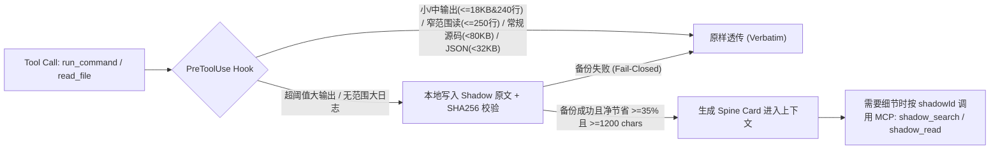

# Antigravity Live Compact (`live-compact`)

面向 **Google Antigravity（App / CLI / IDE）** 的确定性、零额外模型开销的上下文在线压缩插件：在冗长的终端命令输出和大日志读取进入对话上下文之前，于本地压缩为高信息密度的 **Spine Card**，同时以 Fail-Closed 方式落盘 SHA256 校验的 **Shadow 原文备份**，并内置本地 MCP Server 支持按需精准检索原文细节。

> [!IMPORTANT]
> **适用范围声明**：本项目**仅针对 Google Antigravity（App / CLI / IDE）**，**并非 DSH 插件**。  
> 如果你使用的是 DSH，请直接安装原项目：[Tranquillitatis-Lab/dsh-live-compact](https://github.com/Tranquillitatis-Lab/dsh-live-compact)。

## 开源致谢与设计来源

本项目的核心设计思想（用尽可能低的上下文水位维持尽可能高的模型注意力）、Spine Card 骨架提取策略、失败诊断保留规则、防提示词注入声明以及 Fail-Closed 本地 Shadow 备份机制，均深度借鉴并改编自以下优秀的开源项目与分享：

- **原项目**：[Tranquillitatis-Lab/dsh-live-compact](https://github.com/Tranquillitatis-Lab/dsh-live-compact)（原作者 **Merkyor / Tranquillitatis-Lab**，MIT License）
- **设计详解视频**：[用尽可能更低的上下文水位，去保持尽可能高的模型注意力——DSH Live Compact 的设计初衷及实现方案详解](https://www.bilibili.com/video/BV1hBW86wEEj/)（B 站 UP 主 Merkyor）
- **相关参考项目**：
  - [MerkyorLynn/pi-live-compact](https://github.com/MerkyorLynn/pi-live-compact)
  - [Haoming9527/opencode-live-compact](https://github.com/Haoming9527/opencode-live-compact)

在原项目思想基础上，本项目结合 Google Antigravity 的官方插件扩展点（`PreToolUse` / `PreInvocation` Hooks + 本地 Stdio MCP Server + Rules + Skills），完整重写为适配 Antigravity 生命周期的独立插件。

---

## 快速安装（支持多台电脑同步与一键更新）

### 环境要求

- 已安装 **Google Antigravity**（App / CLI / IDE 均可）
- **Node.js >= 22**（纯 Node.js 原生 ESM 实现，**零第三方 npm 依赖**，克隆即用，无需 `npm install`）

### 方式一：直接克隆到 Antigravity 全局插件目录（推荐，全平台通用）

这种方式在 Windows / macOS / Linux 上最稳定，且后续更新只需一行 `git pull`：

**Windows (PowerShell)：**

```powershell
New-Item -ItemType Directory -Force -Path "$env:USERPROFILE\.gemini\config\plugins" | Out-Null
git clone https://github.com/fxxk-five/antigravity-live-compact.git "$env:USERPROFILE\.gemini\config\plugins\live-compact"
```

**macOS / Linux (Bash / Zsh)：**

```bash
mkdir -p ~/.gemini/config/plugins
git clone https://github.com/fxxk-five/antigravity-live-compact.git ~/.gemini/config/plugins/live-compact
```

**后续在任意电脑上拉取更新（自动适配 `git clone` 与直接安装）：**

```powershell
# Windows (PowerShell)
node "$env:USERPROFILE\.gemini\config\plugins\live-compact\scripts\update-check.mjs" --apply
```

```bash
# macOS / Linux
node ~/.gemini/config/plugins/live-compact/scripts/update-check.mjs --apply
```

> [!TIP]
> **自动升级提示**：从 `v1.2.0` 起，插件通过 `SessionStart` Hook 读取本地 12 小时缓存（过期时在后台非阻塞刷新 GitHub Releases / `main/plugin.json`）。检测到新版本时，会在新对话开头直接向用户内联显示升级提示卡片（使用 `metadata.user_markdown` 且 `systemMessage=""`，**零启动阻塞、零模型 Token 消耗**）。设置 `AGY_LIVE_COMPACT_NO_UPDATE_CHECK=1` 可关闭提醒。

### 方式二：通过 `agy plugin install` 安装

```bash
git clone https://github.com/fxxk-five/antigravity-live-compact.git
agy plugin install ./antigravity-live-compact
```

> [!NOTE]
> 在 Windows 上如果 Antigravity App 正在运行，`agy plugin install` 在重命名临时目录时可能触发 `Access is denied`。遇到该情况请直接使用**方式一**克隆到 `%USERPROFILE%\.gemini\config\plugins\live-compact`，Antigravity 会自动发现并热加载。

### 方式三：仅在单个项目生效（工作区级安装）

如果你只想在某个特定仓库启用，可克隆到该项目的 `.agents/plugins/live-compact` 目录：

```bash
git clone https://github.com/fxxk-five/antigravity-live-compact.git ./.agents/plugins/live-compact
```

---

## 验证安装与日常管理

安装完成后，可执行以下命令验证插件结构与 22 项内置门禁测试：

```powershell
# Windows (PowerShell)
agy plugin list
agy plugin validate --strict "$env:USERPROFILE\.gemini\config\plugins\live-compact"
node "$env:USERPROFILE\.gemini\config\plugins\live-compact\scripts\self-test.mjs"
```

```bash
# macOS / Linux
agy plugin list
agy plugin validate --strict ~/.gemini/config/plugins/live-compact
node ~/.gemini/config/plugins/live-compact/scripts/self-test.mjs
```

预期输出：
- `agy plugin list` 显示 `live-compact` 已启用
- `agy plugin validate --strict` 通过（`skills 1, rules 1, hooks 1, mcpServers 1`）
- `self-test.mjs` 输出 `ALL 22 LIVE-COMPACT GATE TESTS PASSED!`

> [!TIP]
> 在 Antigravity App 新建一个对话并发送“查看当前 Live Compact 统计信息”，如果能正常调用 `shadow_stats` 返回会话统计，即说明 Hooks 与 MCP 均已完整生效（已打开的旧对话建议新开对话或刷新后使用）。

### 停用与卸载

- **命令行开关**：`agy plugin disable live-compact` / `agy plugin enable live-compact`（也可在 Antigravity App 的 **Customizations** 面板直接切换开关）
- **环境变量临时跳过**：设置 `AGY_LIVE_COMPACT_DISABLED=1`
- **卸载**：`agy plugin uninstall live-compact`，或直接删除 `~/.gemini/config/plugins/live-compact` 目录

---

## 工作原理与架构对比



### DSH Live Compact vs Antigravity Live Compact

| 维度 | DSH Live Compact (`dsh-live-compact`) | Antigravity Live Compact (`live-compact`) |
| --- | --- | --- |
| **宿主与扩展面** | Open Cordis `ctx.compaction` 服务（替换 `BasicCompactionEngine`） | Google Antigravity 官方插件体系（`hooks.json` + `mcp_config.json` + `rules/` + `skills/`） |
| **压缩时机** | 回合结束 `turn/end` 事后替换（保留最近 3 轮工具输出原样） | **入站在线压缩（In-Flight）**：通过 `PreToolUse` 在超长命令输出与大文件读取进入上下文前完成压缩 |
| **KV Prefix Cache** | 保留 checkpoint 之前前缀，改写切点之后尾部 | **零前缀改写**：Spine Card 一次性写入对话轨迹，不破坏历史 KV Prefix Cache |
| **Shadow 备份** | Fail-Closed 备份至 `~/.dsh/compaction-spine/shadow/<sid>/` | Fail-Closed 原子写入 + SHA256 校验，存至 `~/.gemini/antigravity/live-compact/shadow/<convId>/` |
| **失败诊断保护** | 预算内保留完整失败信息，不将失败命令误判为正常 | 失败命令放宽预算至 `failureBudget`（默认 `6400` 字符），精确过滤通过用例，优先保留真实失败与尾部汇总 |
| **按需召回** | `shadow-search.js` 辅助脚本 | 内置零依赖 Stdio MCP Server（`shadow_search` / `shadow_read` / `shadow_stats`） |
| **水位监控** | `ctx.tokenMeter.measure()` | `shadow_stats` 按需直扫 `transcript_full.jsonl` 实时计算 `input_tokens + cache_read_tokens`（零 `PreInvocation` 同步阻塞） |

---

## 同 Agent A/B 实测效果

在完全相同的任务、模型、思考强度与评测标准下，分别以 **无插件基线（Baseline）** 与 **启用 `live-compact`** 运行同 Agent 对比测试：

### 1. 高难度 8 轮 25 分多模块排障基准（`gemini-4-neon-high`）

任务：6 模块结算引擎 + 5 个跨模块联动 Bug + 600 个自动化测试 + 685 KB 生产日志排查 + 15 分跨工件回忆考题。

| 指标 | Baseline（无插件） | Live Compact（启用插件） | 变化 |
| --- | --- | --- | --- |
| 综合得分（工程修复 + 跨工件考试） | **25 / 25** | **25 / 25** | 质量零折损 |
| 峰值上下文（Peak Context） | 507,852 tokens | **85,965 tokens** | **-83.1%** |
| 平均上下文（Mean Context） | 242,753 tokens | **52,284 tokens** | **-78.5%** |
| 累计 Prompt Tokens | 5,340,571 tokens | **1,202,530 tokens** | **-77.5%** |
| 非缓存输入（Uncached Input） | 555,168 tokens | **102,934 tokens** | **-81.5%** |
| KV Cache 命中率 | 89.6% | **91.4%** | **+1.8 pp**（0 次触发宿主强压缩） |
| 宿主盲截断次数 | 4 次 | **0 次** | 完全消除盲截断 |
| 工具调用次数 | 48 次 | **40 次** | **-16.7%** |
| 总耗时 | 583.57s | **527.43s** | **-9.6%** |

### 2. 中等任务基准（`gemini-3.8-flash-medium`）

- **7 轮日志洪峰 + 细节回忆**：得分 `10/10` vs `10/10`，峰值上下文 **-23.8%**，累计 Prompt **-35.5%**，非缓存输入 **-22.0%**
- **444 测试集排错修复**：得分 `6/6` vs `6/6`，峰值上下文 **-24.5%**，累计 Prompt **-26.0%**

---

## 插件目录结构

```text
antigravity-live-compact/
├── plugin.json                 # Antigravity 插件清单
├── hooks.json                  # SessionStart & PreToolUse 钩子声明
├── mcp_config.json             # 本地 Shadow MCP Server 配置
├── rules/AGENTS.md             # 指导 Agent 正确对待 Spine Card 与按需调用 shadow 工具
├── skills/live-compact/SKILL.md # 查看统计与阈值的内置 Skill
├── assets/logo.svg             # 插件图标
└── scripts/
    ├── hook-dispatch.mjs       # 统一 Hook 分发器（含增量水位监控与过期临时文件清理）
    ├── live-compact-exec.mjs   # 跨平台命令执行包装器（Windows UTF-8 .ps1 / Unix /bin/sh）
    ├── plan.mjs                # Spine Card 确定性压缩规划器与信号提取器
    ├── shadow.mjs              # Fail-Closed 原子落盘、SHA256 校验与索引检索
    ├── mcp-server.mjs          # 零依赖 Stdio MCP Server (shadow_search/read/stats)
    ├── update-check.mjs        # 后台非阻塞版本检查、SessionStart 升级提示与 --apply 一键升级
    └── self-test.mjs           # 22 项端到端门禁自测
```

## 环境变量调优

所有阈值均有保守默认值，可通过环境变量按需覆盖：

| 环境变量 | 默认值 | 说明 |
| --- | --- | --- |
| `AGY_LIVE_COMPACT_DISABLED` | 未设置 | 设为 `1` 可在不卸载插件的情况下临时禁用 Hook |
| `AGY_LIVE_COMPACT_CMD_MODE` | `smart` | `run_command` 包装策略：`smart`（默认）仅对测试/构建/lint/容器日志/`git grep`/递归枚举/无界日志输出等高噪音命令启用包装，常规短命令零开销原样放行；`off` 仅保留 `read_file` 压缩；`all` 全量包装 |
| `AGY_LIVE_COMPACT_CMD_EXTRA_REGEX` | 未设置 | `smart` 模式下追加的自定义高噪音命令正则（忽略大小写），用于纳管项目特有脚本 |
| `AGY_LIVE_COMPACT_NO_UPDATE_CHECK` | 未设置 | 设为 `1` 可关闭 `SessionStart` 自动版本更新提示 |
| `AGY_LIVE_COMPACT_SMALL_CHARS` | `18432` | 命令输出字符数透传阈值（同时满足行数阈值时原样透传，避免压缩中小诊断脚本引发召回返工） |
| `AGY_LIVE_COMPACT_SMALL_LINES` | `240` | 命令输出行数透传阈值 |
| `AGY_LIVE_COMPACT_CARD_BUDGET` | `2800` | 常规输出 Spine Card 字符预算（需净压缩 >= 35% 且 >= 1200 字符才压缩） |
| `AGY_LIVE_COMPACT_FAILURE_BUDGET` | `6400` | 失败命令 Spine Card 字符预算，优先保留错误栈与尾部汇总 |
| `AGY_LIVE_COMPACT_LOG_MIN_BYTES` | `16384` | 无行号范围 `read_file` 读取日志/文本文件的最小压缩字节数（且行数 >= 240） |
| `AGY_LIVE_COMPACT_JSON_MIN_BYTES` | `32768` | 无行号范围 `read_file` 读取 JSON 文件的最小压缩字节数（且行数 >= 400） |
| `AGY_LIVE_COMPACT_CODE_MIN_BYTES` | `81920` | 无行号范围 `read_file` 读取超大源码文件的最小压缩字节数（且行数 >= 1500） |
| `AGY_LIVE_COMPACT_MAX_BOUNDED_LINES` | `250` | 指定 `StartLine`/`EndLine` 且范围不超过该值时直接原样透传 |
| `AGY_LIVE_COMPACT_WATERMARK_TOKENS` | `120000` | （可选，默认不启用 `PreInvocation` 同步 Hook，水位由 `shadow_stats` 按需直扫 `transcript_full.jsonl` 实时计算） |
| `AGY_LIVE_COMPACT_SHADOW_DIR` | `~/.gemini/antigravity/live-compact/shadow` | 自定义本地 Shadow 备份根目录 |

## License

[MIT License](./LICENSE)

本项目面向 Google Antigravity 重新实现，核心理念与压缩策略借鉴并改编自 [Tranquillitatis-Lab/dsh-live-compact](https://github.com/Tranquillitatis-Lab/dsh-live-compact)（MIT License, Copyright (c) 2026 Merkyor）。
